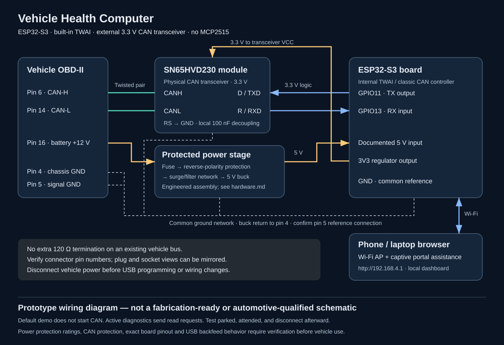

# ESP32 Vehicle Health Computer

A local, browser-based OBD-II telemetry and diagnostic prototype built around the **ESP32-S3's internal TWAI controller and an external 3.3 V CAN transceiver**. No MCP2515, ELM327 firmware, cloud account, or phone application is required.

**Status: engineering prototype. Default firmware runs simulated data without starting CAN. Compilation and software tests do not establish automotive safety or vehicle compatibility.**



## Purpose and use cases

Make vehicle telemetry understandable while learning embedded systems, CAN, diagnostic protocols, and local web interfaces. Use it for a parked-car engineering demonstration, supported-PID inspection, troubleshooting observations, or a portfolio project with transparent firmware and wiring. It reports measurements and stored trouble codes; it does not diagnose failed parts, certify roadworthiness, predict remaining engine life, or replace a scan tool and service manual.

## What works in V1

- Password-protected Wi-Fi access point with DNS captive-portal assistance and an offline dashboard.
- Clearly labeled demo mode, passive listen-only mode, and explicitly enabled diagnostic polling.
- Classic CAN, 11-bit OBD addressing, selectable 500 or 250 kbit/s, one configured ECU.
- Supported-PID discovery across 0x00 / 0x20 / 0x40 ranges.
- RPM, speed, coolant, calculated load, throttle, intake temperature, MAF, fuel level, and ECU voltage when supported.
- MIL and ECU-reported DTC count; manually requested Mode 03 stored trouble-code reads with bounded ISO-TP reassembly.
- Unsupported/stale indicators, error counters, single-shot transmission, fault shutdown, and a 15-minute live-session limit.
- No DTC clearing, actuator tests, ECU programming, raw CAN web console, or remote live-mode switch.

## Why build this instead of buying a cheap scanner?

This is an **open engineering platform**, with editable firmware, visible wiring, custom dashboard behavior, and a reproducible demo. Many inexpensive ELM327-style adapters instead expose an AT-command interface and depend on a separate app. Those products vary widely; this project does not claim better diagnostic coverage, accuracy, protection, or reliability. A reputable commercial scanner usually offers broader protocol support and a more mature enclosure and protection design. Choose this project to learn and customize, not to save money on validated diagnostic equipment.

## Architecture and wiring

| Source | Destination | Notes |
|---|---|---|
| OBD 6 | Transceiver CANH | Twisted pair with CANL |
| OBD 14 | Transceiver CANL | No added vehicle-bus termination |
| OBD 16 | Fuse → reverse-polarity/surge protection → 12 V-to-5 V buck | Never connect to MCU directly |
| OBD 4 / 5 | Documented common ground network | Confirm breakout pin numbering and grounding |
| Buck 5 V | ESP32-S3 board's documented 5 V input | Avoid USB/backfeed conflicts |
| ESP32-S3 3V3 | SN65HVD230 VCC | 3.3 V only |
| GPIO11 / TWAI TX | Transceiver D / TXD | Output from MCU |
| GPIO13 / TWAI RX | Transceiver R / RXD | Input to MCU |
| Transceiver RS | GND for high-speed mode | Verify the module's existing straps |
| Transceiver GND | ESP32 GND | Common signal reference |

The controller generates CAN frames; the transceiver supplies the physical CAN interface. GPIO assignments are configurable and must be checked against your exact board. There are **no SPI, CS, INT, MCP2515, or voltage-divider connections** in this design.

## Quick start: USB demo first

1. Install Arduino IDE and Espressif's **esp32 board package 3.3.12** (the version used for this project's build).
2. Open `firmware/VehicleHealthComputer/VehicleHealthComputer.ino`. Keep its three companion headers in the same directory.
3. Select **ESP32S3 Dev Module**, or the exact supported board you own. Match flash size and USB/upload settings to that board.
4. Leave `DEMO_MODE=true` and `ENABLE_OBD_REQUESTS=false` in `config.h`. Change `AP_PASSWORD` before real use. The published value is only an example.
5. Upload using USB, with the vehicle disconnected. Join Wi-Fi **VehicleHealth**, initial password **ChangeMe-OBD32**.
6. Open **http://192.168.4.1/**. If the captive page does not open automatically, use that address. Stay connected even if your phone says “no internet.”
7. Demo shows synthetic values. “Read stored DTCs” displays a deliberately simulated P0300 example.

No third-party Arduino libraries are required: WiFi, WebServer, DNSServer, and the TWAI driver come with the ESP32 core.

### Moving to a vehicle

Follow [hardware design](docs/hardware.md) and [bring-up checklist](docs/bring-up.md) first. Verify the vehicle's CAN bitrate, 11-bit diagnostic addressing, and selected ECU. Use `DEMO_MODE=false`, `ENABLE_OBD_REQUESTS=false` for passive inspection; passive mode does not solicit PIDs. Only after bench validation, set both `DEMO_MODE=false` and `ENABLE_OBD_REQUESTS=true` for diagnostic reads. Rebuild and upload while disconnected from the car.

**Read-only is a service-level restriction, not electrical silence.** Live mode sends diagnostic queries and ISO-TP flow control; normal CAN mode can acknowledge frames and emit error frames. Only passive listen-only mode suppresses controller transmissions. Demo disables the controller but does not physically isolate attached hardware.

## Repository map

```text
firmware/VehicleHealthComputer/  Arduino sketch, configuration, decoder, dashboard
hardware/block-diagram.svg      Editable electrical block/wiring diagram
hardware/block-diagram.png      Rendered diagram for viewing and sharing
hardware/wiring.csv             Pin-to-pin wiring reference
docs/hardware.md               BOM, power protection, assembly constraints
docs/firmware.md               Protocol scope, state machine, API, PID formulas
docs/bring-up.md               Bench-to-vehicle validation checklist
docs/validation.md             Actual verification and remaining hardware tests
docs/roadmap.md                Planned work, explicitly not implemented
docs/references.md             Manufacturer and protocol references
tests/                         Host-side protocol regression tests
.github/workflows/build.yml    Arduino compile and host-test CI
```

## Limits and safety

V1 has no K-line, J1850, CAN FD, 29-bit OBD, automatic bitrate discovery, OEM ABS/SRS/body diagnostics, VIN retrieval, freeze frames, pending/permanent DTC services, cloud, storage, OTA, or guaranteed captive popup. Some vehicles require a gateway authorization or do not answer the configured physical address. One ECU's empty DTC list does not mean the whole vehicle has no faults. ECU voltage is not a calibrated battery measurement; no voltage divider or direct battery ADC is included.

SN65HVD230 hobby boards are for controlled prototyping and are **not a validated automotive front end**. Protection blocks in the drawing require an engineered implementation. Do not use a bare hobby buck as proof of load-dump protection. Never probe or rewire a powered connector. Use a fused, current-limited bench supply first. Do not add a 120-ohm resistor to an already terminated vehicle bus. Do not operate the dashboard while driving, leave the prototype plugged in unattended, or assume the session timeout removes power. OBD pin 16 can remain live with ignition off. Disconnect after testing.

See [system details](docs/firmware.md), [verification evidence](docs/validation.md), and [roadmap](docs/roadmap.md). Contributions should include recorded bench test evidence; never commit VINs, locations, Wi-Fi secrets, or identifiable vehicle logs.

## License

MIT; see [LICENSE](LICENSE). Hardware guidance is provided as prototype documentation without certification or warranty.
